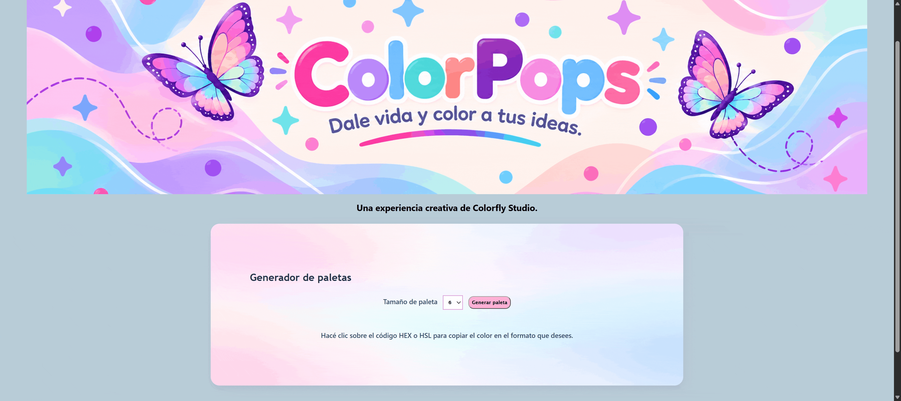

# ColorPops

## Enlace al proyecto

[Ver ColorPops](https://macarenaperez95.github.io/ProyectoM1_MacarenaPerez/)

## Descripción del proyecto

ColorPops es una página web desarrollada como parte del Proyecto Integrador M1, bajo la consigna ColorFly Studio.

Permite generar paletas de colores de manera aleatoria. El usuarioo puede elegir entre 6, 8 o 9 colores y copiar sus códigos HEX y HSL para utilizarlos en sus propios proyectos. 

## Funcionalidades 

 - Generar paletas de 6, 8 o 9 colores aleatorios. 
 - Visualizar los colores generados y sus códigos HEX y HSL.
 - Copiar los códigos HEX y HSL de manera independiente con un clic.
 - Diseño adaptable a diferentes tamaños de pantalla. 

 ## Cómo utilizar ColorPops

1. Al ingresar a la página, nos dirigimos al selector **Tamaño de paleta**, donde podemos elegir entre 6, 8 o 9 colores.
2. Una vez seleccionada la cantidad de colores, hacemos clic en el botón **Generar paleta**.
3. La página genera automáticamente los colores aleatorios y muestra debajo de cada uno sus códigos HEX y HSL.
4. Para copiar un código, simplemente hacemos clic sobre el formato deseado (HEX o HSL).
5. El código se copia al portapapeles. 

## Decisiones técnicas

Para desarrollar ColorPops se utilizó HTML, CSS y JavaScript, siguiendo los requisitos del Proyecto Integrador M1 de Henry.

 - **HTML:** se utilizó para crear y organizar la estructura de la página web.
 - **CSS:** se utilizó para diseñar la apariencia visual del proyecto, incluyendo los colores, los estilos y la distribución de los elementos.  
 - **JavaScript:** se utilizó para darle funcionalidad a la página, permitiendo generar paletas de colores aleatorias y copiar sus códigos HEX y HSL.

## Cómo ejecutar el proyecto

1. Ingresar al repositorio de ColorPops en GitHub.
2. Descargar el proyecto en formato ZIP.
3. Descomprimir el archivo en la computadora. 
4. Abrir Visual Studio Code. 
5. Seleccionar **Archivo** → **Abrir carpeta** y elegir la carpeta del proyecto. 
6. Buscar el archivo "index.html".
7. Hacer clic derecho sobre "index.html" y seleccionar **Open With Live Server**.
8. La página se abrirá automáticamente en el navegador y estará lista para utilizarse.

**IMPORTANTE:** para utilizar esta opción, debe tener instalada la extensión **Live Server** en **VS Code**.

## Cómo desplegar el proyecto

1. Ingresar a GitHub y seleccionar el repositorio del proyecto.
2. Ir a la pestaña **Settings** (Configuración).
3. En el menú lateral izquierdo, seleccionar **Pages**.
4. En la sección **Build and deployment**, elegir **Deploy from a branch**.
5. Seleccionar la rama **main** y la carpeta **/ (root)**. 
6. Hacer clic en **Save** para guardar la configuración.
7. Esperar unos minutos hasta que GitHub Pages publique la página.
8. Una vez publicado, acceder al enlace generado para visualizarlo. 

## GIF del proyecto

### Paleta de 6 colores

## Uso de Inteligencia Artificial

Durante la cursada y el desarrollo de ColorPops utilicé ChatGPT como herramienta de apoyo para repasar conceptos, resolver dudas y revisar mi código.

Documenté los prompts utilizados, las respuestas obtenidas y las capturas de las conversaciones.

[Ver documentación del uso de IA](./USO_IA.md)

## Autoría

**Macarena Pérez**

Proyecto Integrador M1 de Full Stack en Henry.

