# Documentación del uso de Inteligencia Artificial

## Proyecto: ColorPops

**¿Cómo utilicé la inteligencia artificial durante mi aprendizaje?**

Desde que comencé a estudiar Full Stack en Henry, utilicé ChatGPT como una herramienta de apoyo, principalmente como si fuera un profesor particular o un tutor que me acompañaba durante el aprendizaje.

Mi forma de estudiar era leer primero el material teórico que nos daba Henry y después recurrir a ChatGPT para repasar los temas, hacer preguntas y entender mejor aquellos conceptos que me costaban un poco más.

Muchas veces le pedía que me explicara las cosas de una manera más sencilla, con ejemplos y ejercicios prácticos para poder poner a prueba lo que había aprendido. Íbamos haciendo ejercicios juntos, de menor a mayor dificultad, y cuando me equivocaba le pedía que me explicara el error para poder intentarlo nuevamente.

Esto me ayudó mucho a reforzar los conocimientos, practicar lo visto en las clases y avanzar a mi propio ritmo.

**¿Cómo utilicé ChatGPT durante el desarrollo de ColorPops?**

Cuando llegó el momento de comenzar el Proyecto Integrador M1, le compartí a ChatGPT toda la consigna que nos había dado Henry, incluyendo capturas de pantalla con los requisitos, las funcionalidades y los puntos que teníamos que cumplir.

Le expliqué que quería que me acompañara durante el desarrollo del proyecto, pero de una manera particular: no quería que me resolviera todo ni que me diera el código directamente, sino que me ayudara a aprender a hacerlo por mi cuenta.

Desde el principio le pedí que funcionara como un tutor, que me guiara paso a paso y que respetara mis tiempos. La idea era que yo pudiera pensar, probar, equivocarme y encontrar las soluciones.

Cuando tenía alguna duda, le consultaba y me explicaba el concepto. Si algo no me quedaba claro, le pedía otra explicación, algún ejemplo o incluso un ejercicio para practicarlo antes de aplicarlo al proyecto.

También le aclaré que solamente cuando yo se lo pidiera específicamente podía darme una respuesta directa, una pista más concreta o un fragmento de código.

Durante el desarrollo de ColorPops mantuvimos muchas conversaciones. Le iba mostrando lo que hacía, compartía partes de mi código y le consultaba cuando algo no funcionaba como esperaba. En esos casos, me ayudaba a identificar los errores y a entender por qué ocurrían.

En algunas ocasiones también le pedí que revisara mi código, me ayudara a organizarlo o me mostrara cómo quedaría una solución para poder compararla con lo que yo había hecho.

En definitiva, utilicé ChatGPT como una herramienta de estudio y acompañamiento durante todo el proceso, tanto para repasar y practicar conceptos como para avanzar con el proyecto.

Mi intención siempre fue aprender a programar, entender lo que estaba haciendo y desarrollar mi propia lógica, en lugar de simplemente copiar y pegar código sin comprenderlo.

## Prompts utilizados y resultados

### 1. Inicio del proyecto y acompañamiento de la IA

- **Prompt utilizado:**
Para comenzar con ColorPops, primero le compartí a ChatGPT todas las consignas que nos había dado Henry mediante capturas de pantalla.

Después le expliqué cómo quería trabajar durante el proyecto. Le pedí que fuera mi guía, que me acompañara paso a paso y que no me diera directamente las respuestas ni el código, porque mi intención era aprender a hacerlo por mi cuenta.

También le comenté que nece**sitaba trabajar con HTML, CSS y JavaScript, realizar commits durante el desarrollo y documentar el uso de la IA.

- **Resultado obtenido:**
ChatGPT me propuso organizar el proyecto por etapas, comenzando con HTML, siguiendo con CSS y JavaScript, y después continuar con Git, GitHub, las pruebas y la documentación.

También acordamos una forma de trabajar en la que yo escribiría el código y podría consultar mis dudas, pedir explicaciones o solicitar ayuda cuando algo no me saliera.

La idea era que pudiera ir aprendiendo mientras desarrollaba el proyecto, entendiendo cada cosa que hacía.

- **Evidencias:**

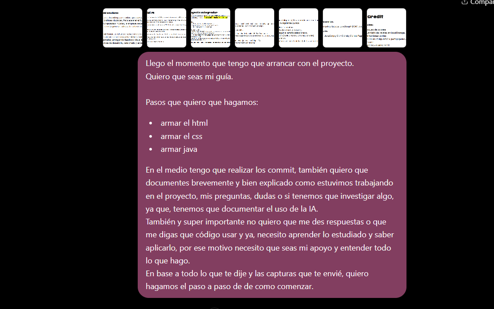

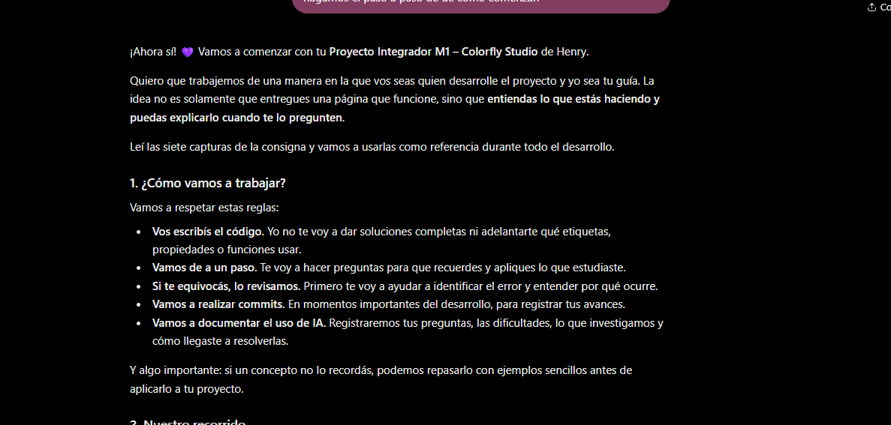

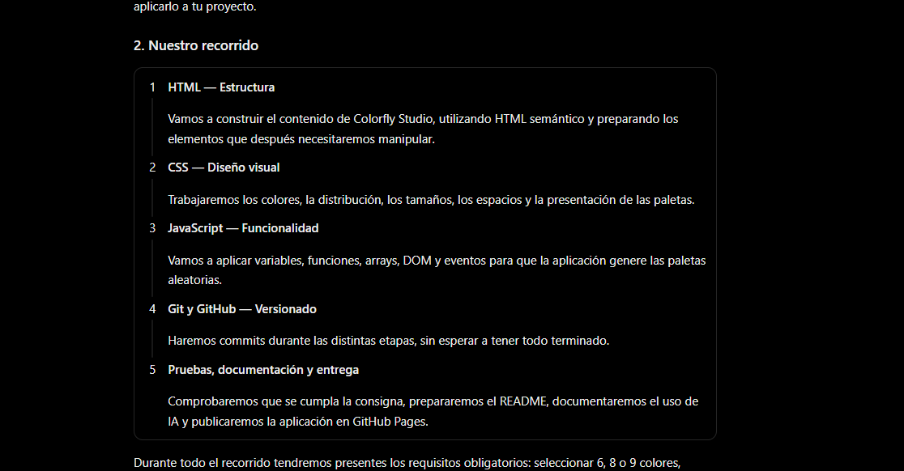

- **Nota:**
La respuesta de ChatGPT fue más extensa, por eso incluí solamente dos capturas que muestran cómo comenzamos a organizar el proyecto y nuestra forma de trabajar. Estas imágenes son solo una parte de la conversación, no la respuesta completa.

### 2. Aplicación de conceptos de JavaScript

- **Prompt utilizado:**
Mientras trabajaba en la generación de colores aleatorios, fui relacionando los conceptos que había aprendido en Henry con lo que necesitaba hacer en ColorPops.

En esta conversación intenté utilizar un bucle for para repetir la generación de colores y le compartí a ChatGPT cómo pensaba hacerlo.

- **Resultado obtenido:**
ChatGPT me confirmó que la estructura del bucle for que había escrito era correcta y me ayudó a relacionarlo con Math.random(), que estábamos utilizando para generar colores aleatorios.

Esta conversación me sirvió para empezar a entender cómo aplicar los conceptos de JavaScript que había estudiado a una funcionalidad real de mi proyecto.

- **Evidencia:**

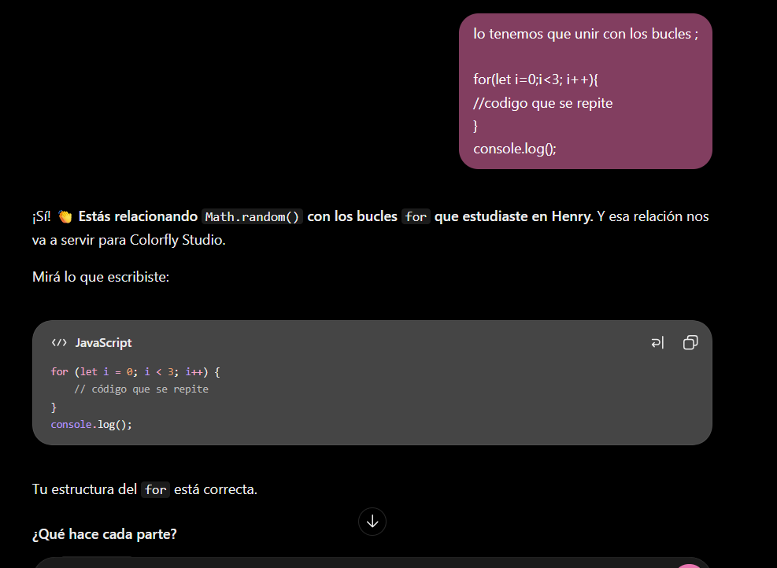

### 3. Conversión de colores HSL a HEX

- **Prompt utilizado:**
Mientras desarrollaba ColorPops, necesitaba aprender cómo convertir los colores que generaba en formato HSL a códigos HEX.

Le pedí a ChatGPT que me explicara cómo funcionaba esa conversión, porque sabía que necesitaba utilizar una función con parámetros, pero todavía no entendía cómo realizar el procedimiento.

Después de la explicación, intenté escribir mi propia función convertirAHex() y se la compartí para que revisara si estaba bien planteada.

- **Resultado obtenido:**
ChatGPT me explicó que para convertir un color HSL a HEX primero había que obtener sus valores RGB y después transformarlos a hexadecimal.

Me mostró ejemplos para entender cómo funcionaba la conversión y me explicó cómo podía utilizar los parámetros de mi función.

También revisó la estructura que había escrito y me confirmó que podía continuar trabajando con ella.

Esta conversación me ayudó a entender mejor el proceso de conversión y cómo aplicarlo a ColorPops.

- **Evidencia:**

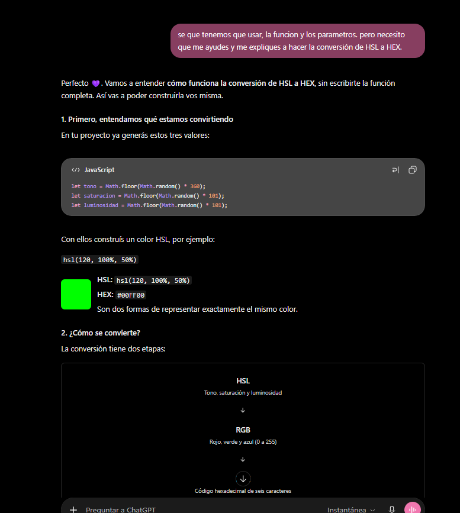

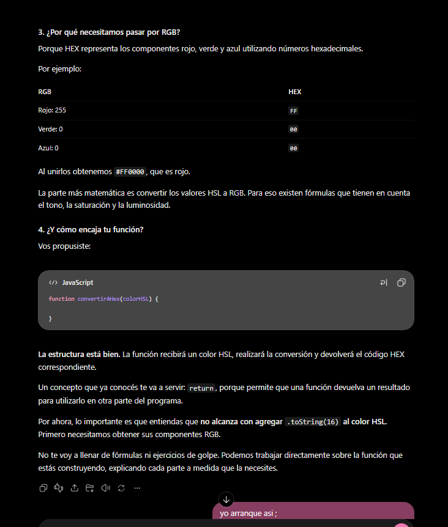

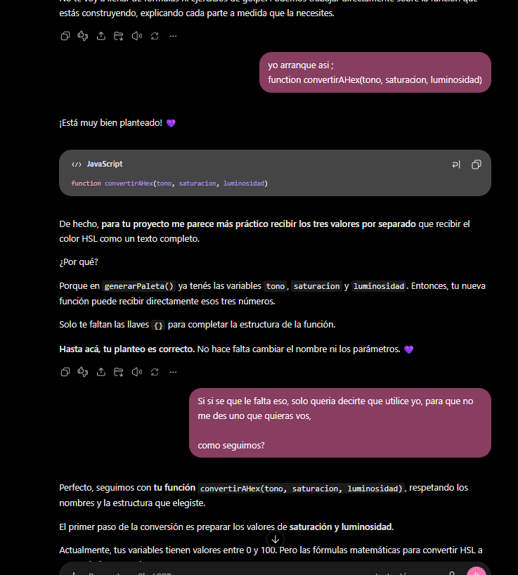

### 4. Uso de clases en HTML y CSS 

- **Prompt utilizado:**
Mientras trabajaba en el diseño de ColorPops, quería modificar el tamaño de un párrafo, pero me di cuenta de que si cambiaba directamente la etiqueta p en CSS, se modificaban todos los párrafos de la página.

Le planteé esta duda a ChatGPT para entender cómo podía cambiar solamente el párrafo que necesitaba.

- **Resultado obtenido:**
ChatGPT me explicó la diferencia entre utilizar una etiqueta general y una clase en CSS.

Me propuso identificar el párrafo con una class para poder modificarlo sin afectar a los demás elementos.

Después fui escribiendo el código y repasando cómo se utilizan las clases en HTML y cómo se seleccionan desde CSS.

Esta conversación me ayudó a comprender mejor cómo aplicar estilos específicos a los elementos de mi página.

- **Evidencia:**

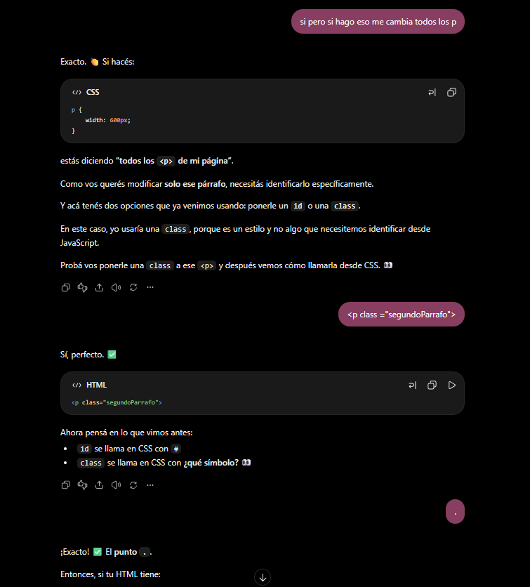

- **Nota:**
 Más adelante fui haciendo algunos cambios en el diseño de ColorPops y terminé sacando ese segundo párrafo. Aunque ya no forma parte de la versión final de la página, esta conversación me sirvió para reforzar mis conocimientos sobre el uso de las clases en HTML y CSS.

### 5. Revisión final del código de ColorPops

- **Prompt utilizado:**
Cuando ya tenía desarrollado el proyecto, le compartí a ChatGPT capturas de todo mi código HTML, CSS y JavaScript para que hiciera una revisión general.

Le pedí que comprobara si estaba bien organizado, si las separaciones y los comentarios eran correctos y si encontraba algún error.

También le aclaré que no quería que modificara nada ni que me diera código nuevo, sino que solamente revisara lo que yo había hecho.

- **Resultado obtenido:**
ChatGPT revisó las tres partes del proyecto y me indicó que la estructura general estaba bien organizada y que la lógica principal de JavaScript era correcta.

También me señaló algunos detalles que podía mejorar, como ciertos comentarios, propiedades CSS y el mensaje que aparecía al copiar un color.

Esta revisión me sirvió para comprobar mi trabajo, identificar pequeños detalles y evaluar qué cosas necesitaba corregir antes de la entrega.

- **Evidencias:**

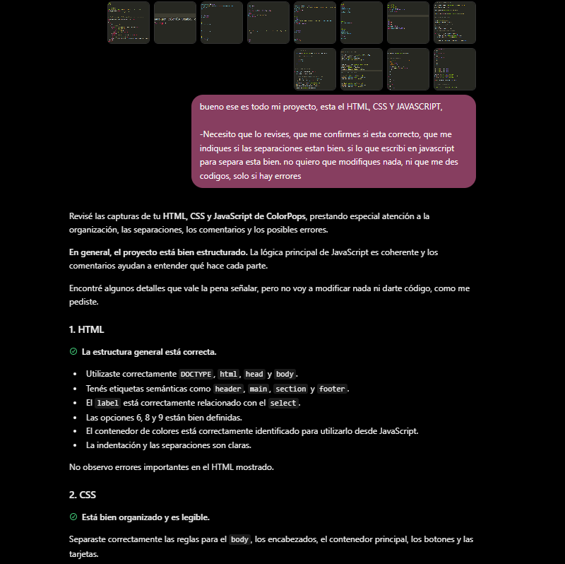

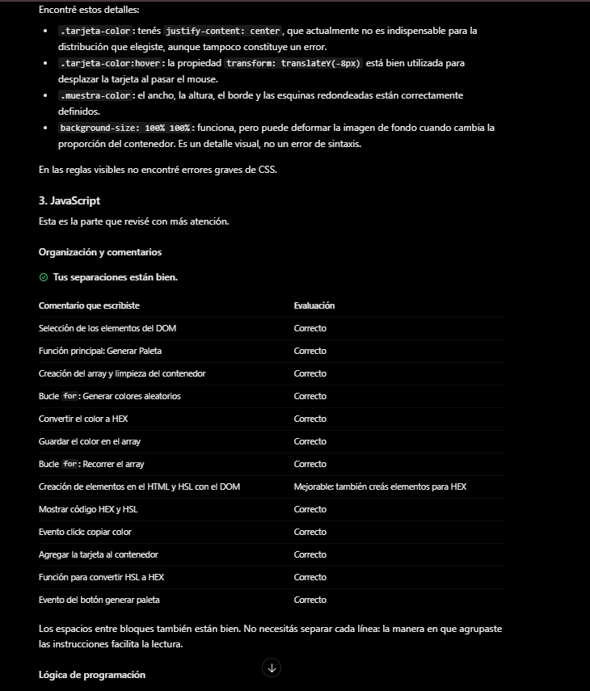

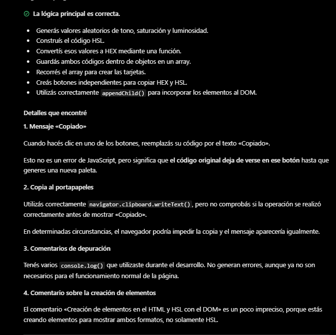

### Conclusión

Desde que empecé a estudiar en Henry, ChatGPT me acompañó bastante en mi aprendizaje. Muchas veces terminaba de leer el material y necesitaba repasar, practicar o que me explicaran las cosas de otra manera para poder entenderlas mejor.

Durante el desarrollo de ColorPops me ayudó mucho tener esa posibilidad de consultar, equivocarme, volver a intentar y avanzar a mi ritmo. Hubo momentos en los que me costó bastante, pero siempre traté de pensar y resolver las cosas por mi cuenta antes de pedir una respuesta.

También aprendí que la IA no siempre tiene razón y que está bueno cuestionar sus respuestas cuando algo no me cierra.

Me quedo contenta con todo lo que fui aprendiendo. Más allá de haber terminado ColorPops, para mí lo más importante fue darme cuenta de que podía ir resolviendo cosas que al principio me parecían muy difíciles, y entender cada vez un poquito más lo que estaba haciendo.

